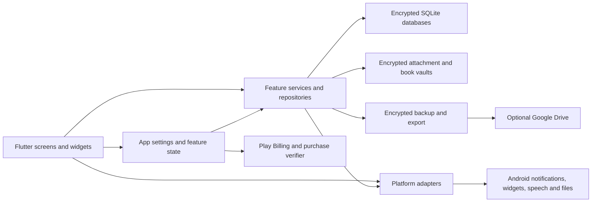

# Bilga

[](https://github.com/abdulAziz-Al-ILM/Bilga-Lokal/actions/workflows/ci.yml)

[](LICENSE)

Bilga is an offline-first Flutter app for Android. It puts notes, tasks, habits, personal finances, journals, and books in one place, with encrypted local storage and optional encrypted backups.

## Showcase

Capture the English UI with synthetic records on a phone or emulator at **1080 × 1920 px**. The paths below are reserved for those captures.

| Asset | Capture |
| --- | --- |
| `docs/showcase/demo.gif` | **720 × 1280 px, 12 fps, 15 seconds.** From Home, create a note, find it with library search, then open a saved book. |
| `docs/showcase/home.png` | **1080 × 1920 px.** Home with Today and the module carousel visible. |
| `docs/showcase/notes.png` | **1080 × 1920 px.** A sample rich-text note with a tag and a readable title. |
| `docs/showcase/tasks.png` | **1080 × 1920 px.** A task with subtasks, a due time, and the reminder control. |
| `docs/showcase/reader.png` | **1080 × 1920 px.** The bundled EPUB sample with the reader toolbar and chapter controls visible. |

## Features

- Write and organize rich-text notes with tags, history, and trash. Search supported records across modules while offline.
- Plan tasks with checklists, recurring schedules, reminders, projects, and Android widgets.
- Track habits and reflect on experiments or journal entries. Track personal transactions, budgets, and savings goals.
- Read PDF, EPUB, and TXT books with saved positions, bookmarks, and reading settings. Read accessible document text aloud in Uzbek, English, or Russian.
- Export records, create password-protected local backups, or connect Google Drive for optional backup. Local backups support attachments.
- Choose from 43 interface locales and seven color palettes. The app defaults to English on a fresh install and retains saved language choices.

## Architecture

The code is organized by feature under `lib/features/`. Shared localization, settings, security, and UI primitives live in `lib/core/`. Widgets own short-lived interaction state. App-wide settings and access use Flutter's `ChangeNotifier`, and feature stores can receive an injected database in tests. This keeps rebuilds local and gives tests a way to exercise real transactions in isolation.

Notes and tasks keep separate SQLite databases opened with SQLCipher on Android. Attachment and book vaults use authenticated encryption. Additive migrations retain existing databases through upgrades. A task editor save writes its task, checklist, reminder, and recurrence within one transaction, then emits a change event for derived views and the Android cache.

The reader page coordinates document lifecycle, reading state, and persistence. Its toolbar, content views, appearance sheet, and navigation controls render that state through callbacks. Android-specific operations such as notification permission, widgets, speech, and file selection sit behind Flutter method channels. Play Billing and optional Drive backup use separate adapters. Previously verified lifetime access stays available offline.



## Tech stack

| Area | Technology |
| --- | --- |
| App | Flutter 3.47.8, Dart 3.13.1, Material, Android API 26+ |
| State and localization | Flutter `ChangeNotifier`, widget-local state, JSON catalogs |
| Storage and security | SQLite, SQLCipher, Android Keystore, authenticated encryption |
| Documents and audio | Flutter Quill, pdfrx, EPUB/TXT readers, Android speech |
| Services | Google Drive, Google Play Billing, Python purchase verifier |
| Verification | Flutter unit and widget tests, SQLite FFI fixtures, Android instrumented tests, GitHub Actions |

## Getting started

Install Flutter **3.47.8**, JDK **21**, Android SDK Platform **36**, and Android NDK **28.2.13676358** for Android builds. Install Clang and the SQLite runtime for Linux host tests. Confirm the environment with `flutter doctor -v`.

Run the offline app on an Android emulator or development phone.

```bash
flutter pub get --enforce-lockfile
flutter run
```

For optional integrations, copy the example and enter only the public values required by the integration.

```bash
cp .env.example .env
flutter run --dart-define-from-file=.env
```

The offline experience works with the example values left empty. Use the OAuth **web client ID** for Drive. Set the Play public license key, verifier URL, and verifier public key together for billing. Keep service credentials and signing private keys on the server or in the local signing configuration. See the [purchase verifier setup](backend/purchase_verifier/README.md).

```bash
dart format --output=none --set-exit-if-changed lib test integration_test
flutter analyze
flutter test --coverage
python3 tool/check_catalogs.py
```

Android hardware checks use the isolated **Bilga Review** package. Release signing requires the existing upload key. See the [release verification evidence](docs/RELEASE_READINESS.md) and [Play release checklist](release/PLAY_LAUNCH_CHECKLIST.md) for build status, device results, and billing prerequisites.

## License

Bilga’s original source code is licensed under the [GNU General Public License, version 3](LICENSE) (`GPL-3.0-only`). Third-party components retain the terms in their accompanying licenses and notices.
